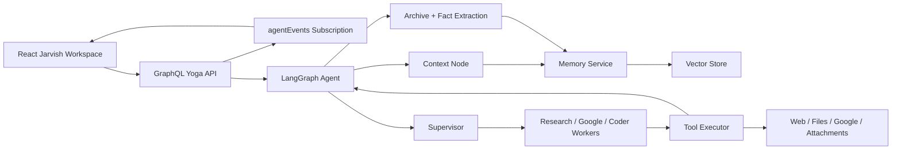

# Jarvish

Jarvish is an AI agent workspace built with React, TypeScript, GraphQL Yoga, LangGraph, Gemini, SQLite/Drizzle, and a replaceable vector-memory layer. The app opens directly into the Jarvish agent experience, with a secondary code-split capability lab for frontend patterns such as reliable submit flows, retry UX, access-control wrappers, virtualized rendering, and dynamic forms.

The repository is organized as a portfolio-grade full-stack AI project:

```txt
src/
  backend/       GraphQL API, LangGraph agent, memory, tools, persistence
  frontend/      React app shell, Jarvish UI, lazy-loaded capability demos
  shared/        Shared constants and block contracts used by both sides
docs/
  architecture/  Focused notes on the core AI system boundaries
```

## Reviewer Path

If you have 5 minutes:

1. `src/frontend/App.tsx` - Jarvish-first shell, optimistic capability selection, and lazy loading.
2. `src/frontend/capabilities.ts` - typed capability registry and code-splitting boundaries.
3. `src/backend/agent/graph/topology.ts` - the LangGraph workflow in one readable file.
4. `src/backend/agent/tools/tool-executor.ts` - schema-validated tool execution with confidence scoring.
5. `docs/architecture/agent-graph.md` - short explanation of graph responsibilities and routing.

If you have 15 minutes:

1. `src/frontend/features/jarvishAgent/` - chat workspace, memory panel, structured response blocks, GraphQL client.
2. `src/backend/graphql/` - schema, resolvers, mappers, and subscription event stream.
3. `src/backend/services/memory/` - vector-store abstraction, Gemini embeddings, memory curation, and default SQLite vector storage.
4. `docs/architecture/engineering-decisions.md` - tradeoffs, constraints, and known next steps.

## Architecture

Jarvish separates the app into four reviewable boundaries:

- [Agent graph](docs/architecture/agent-graph.md) - how LangGraph coordinates context, processing, supervision, workers, tools, clarification, and archival.
- [Memory layer](docs/architecture/memory-layer.md) - how memories are embedded, stored, retrieved, filtered, and scoped.
- [Tool execution](docs/architecture/tool-execution.md) - how model tool calls are schema-validated, executed, scored, and returned to the graph.
- [GraphQL boundary](docs/architecture/graphql-boundary.md) - how the frontend talks to the agent through queries, mutations, and subscriptions.
- [Engineering decisions](docs/architecture/engineering-decisions.md) - why the main boundaries exist and what tradeoffs remain.



## Local Setup

Create `.env` from `.env.example`, then provide the keys you need for the surfaces you plan to exercise.

```bash
npm install
npm start
```

`npm start` runs GraphQL codegen first, starts the backend, waits for `/api/health`, and then starts the frontend. The frontend defaults to `http://localhost:5173` and will fall forward if that port is busy. The backend GraphQL endpoint runs on `http://localhost:3000/graphql`.

For frontend-only review:

```bash
npm run dev
```

Some Jarvish agent flows require the backend and `GEMINI_API_KEY`.

Vector memory persists to `sqlite.db` by default. Set `VECTOR_STORE_PROVIDER=memory` only when you want an ephemeral in-memory store for local testing.

To verify the configured Gemini key/model directly:

```bash
npm run diagnose:gemini
```

For active schema/client development:

```bash
npm run start:watch
```

## Environment

```txt
GEMINI_API_KEY=required for hosted model reasoning
GEMINI_REASONING_MODEL=optional, defaults to gemini-2.5-flash
GEMINI_PROCESSING_MODEL=optional, defaults to GEMINI_REASONING_MODEL
GEMINI_TOOL_EXECUTION_MODEL=optional, defaults to GEMINI_REASONING_MODEL
GEMINI_ARCHIVE_MODEL=optional, defaults to GEMINI_REASONING_MODEL
GEMINI_EMBEDDING_MODEL=optional, defaults to gemini-embedding-001 when EMBEDDING_PROVIDER=gemini
EMBEDDING_PROVIDER=optional, local by default; set to gemini for Gemini embeddings
ARCHIVE_AI_ENRICHMENT_ENABLED=optional, false by default; enables model-based summaries and fact extraction
SHADOW_TOOLING_ENABLED=optional, false by default; enables model-based prefetch predictions
VITE_GOOGLE_CLIENT_ID=optional for frontend Google auth
GOOGLE_CLIENT_ID=optional backend config endpoint value
SERPER_API_KEY=optional web search provider
GOOGLE_SEARCH_API_KEY=optional Google Custom Search provider
GOOGLE_SEARCH_CX=optional Google Custom Search engine id
PORT=optional backend port, defaults to 3000
LOG_LEVEL=optional pino log level
VECTOR_STORE_PROVIDER=optional, sqlite by default; set to memory for ephemeral local storage
```

## Verification

These commands should pass before this repo is shared publicly:

```bash
npm run lint
npm run smoke:jarvish
npm run build
```

Or run the full local gate:

```bash
npm run verify
```

Current build note: the production build intentionally lazy-loads secondary capabilities, but Shiki language assets used by structured code blocks can still produce large async chunks. That is a known optimization target rather than a correctness issue.
